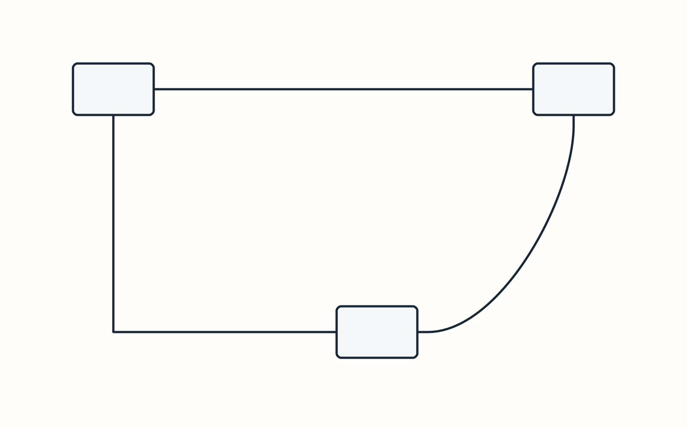

# Connectors for Goodtype

Connectors adds port snapping, straight, curved and orthogonal routing, and optional arrowheads to Goodtype. See [how to use it](ADDON.md).



## Build and verify

Use Windows x64, the pinned Rust toolchain and Python 3.12.

```powershell
cargo xtask verify
cargo build --release --locked
python scripts/package.py
```

The script verifies the extracted executable and writes the ZIP and SHA-256 checksum to `target/package`. To regenerate the preview after building, install PyMuPDF and run `python scripts/preview.py`.

## Release

CI packages and tests the executable on Windows. A tag matching the manifest version on the main branch publishes through the protected release environment. Configure its `ADDON_SIGNING_KEY` secret and commit the matching Ed25519 public key as `release-public-key.pem` before publishing.

## Host contract

Connectors 0.2.0 requires a Goodtype build that implements the connector arrows contract and offers both `page-batch-v0` and `path-edit-v0` over `goodtype-api 0.1`. This capability check is the minimum host requirement. The Windows AppContainer session uses JSON-RPC over stdin and stdout.

The `change-routing` own-object command declares `pathEdit` with the `routing` choice and `ports` snapping. A port drop adopts a capped line or open spline and attaches the dropped end using the Connect tool's routing preference. A routing pick adopts it with two free ends or changes an owned connector's route. The host commits a port drop immediately with Undo. Routing picks follow the host's proposal and direct-apply settings.

An edit returns exactly one `updateObject` for the captured ID inside `batch.operations`, with local centerline geometry and a single addon entry. Creation uses the addon-ID map. Reactions also write single entries and return an empty operations array when there is no change. Saved connector data is version 2. Core style caps render arrowheads and survive rerouting and detaching. An explicit edit or relevant reaction can upgrade a verified legacy wing path. If the saved geometry no longer matches the legacy signature, the request returns an upgrade-review error and preserves the drawing.

The router prefers a few bends and keeps attached-part clearance when possible. A reaction reply carries up to 32 operations, so the host must scope reaction requests accordingly. Only the attached parts are considered because the session receives their snapshots. With omitted outline color and width, the host supplies the pen. Its final outline bounds check uses the actual pen width.

Licensed under [Apache 2.0](LICENSE).
